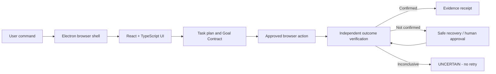

# AFTERCLICK

<p align="center">
  
</p>

<p align="center">
  <strong>Browse. Understand. Act. Verify.</strong><br/>
  <em>A browser that turns intentions into verified outcomes.</em>
</p>

<p align="center">
  <a href="https://github.com/Meghnapoojary/afterclick-browser/actions/workflows/windows-installer.yml">
    
  </a>
  
  
</p>

<p align="center">
  <a href="https://github.com/Meghnapoojary/afterclick-browser/releases/download/v0.6.2/AFTERCLICK-Setup-0.6.2-x64.exe"><strong>↓ Download AFTERCLICK for Windows</strong></a>
  &nbsp;·&nbsp;
  <a href="https://github.com/Meghnapoojary/afterclick-browser/releases">All releases</a>
</p>

AFTERCLICK is a desktop browser built with **Electron, Chromium, React and TypeScript**. It combines everyday browsing with a guided task workspace: give it a goal, inspect its plan, approve consequential actions, and see evidence of the result.

The idea behind AFTERCLICK is simple:

> **Execution is not completion. Verification is.**

## Why AFTERCLICK?

Traditional browser automation often treats a successful click or a returned response as proof that a task is complete. But a website can process an action and lose the confirmation response—or fail before processing it.

AFTERCLICK's MVP demonstrates a safer pattern: record the intended outcome, execute only after approval, independently check the result, and avoid blindly repeating an action when its status is unknown.

## What you can try in this MVP

| Experience | What currently works |
| --- | --- |
| **Desktop browser** | Chromium-based website rendering, tabs, address bar, navigation and ordinary browsing |
| **One command bar** | The home-page command field and browser omnibox use the same command dispatcher |
| **AFTERCLICK Search** | Branded search results with source links and snippets |
| **Page understanding** | Extracts visible page text and creates a short extractive summary |
| **Appointment research** | Opens three controlled provider pages and compares fees, time slots, ratings and areas |
| **Goal Contract** | Captures the supported task's intended outcome, constraints and expected postconditions |
| **Human approval** | Requires provider selection, patient name and explicit demo-checkout approval before booking |
| **Outcome assurance** | Checks a separate local booking ledger instead of trusting the browser's success message |
| **Recovery** | Demonstrates a committed booking with a lost response, a request dropped before commit, and an unavailable history source |
| **Evidence receipt** | Shows appointment details, simulated payment reference, booking reference, verification result and action history; can be printed or saved as PDF |

## The signature demo: a lost confirmation, recovered safely

The appointment workflow uses controlled local test providers. It is designed to show why AFTERCLICK verifies outcomes instead of simply retrying.

### 1. Request submitted — confirmation lost

The Carewell test provider creates the appointment record, but deliberately drops the confirmation response. AFTERCLICK shows the signal interruption and pauses. It then checks the independent booking ledger, finds one matching record and reports **LOST · RECOVERED**.

**It does not submit the booking again.**

### 2. Request dropped before the booking is created

The Northstar test provider drops the first request before committing an appointment. AFTERCLICK checks the authoritative history, confirms that no matching booking exists, marks the outcome **NOT BOOKED**, and asks for fresh approval before a new attempt.

### 3. Booking history cannot be checked

When the history source is unavailable or inconclusive, AFTERCLICK marks the outcome **UNCERTAIN**. The next history check is read-only: no second booking request is sent while the outcome remains uncertain.

## Try the demo

1. Start AFTERCLICK and use the single command field on the new-tab page.
2. Try a normal search, for example: `best budget laptops`.
3. Then enter:

   `Find an appointment tomorrow between 4 PM and 6 PM, under ₹500. Compare three providers and recommend the best available option.`

4. Review the provider comparison and choose an option.
5. Enter the name for the appointment and choose a demo payment method.
6. Read the checkout notice and explicitly approve the simulated payment and booking.
7. For **Carewell**, watch the confirmation signal get lost, then watch AFTERCLICK check the booking ledger and recover the confirmed result.
8. Open the receipt to review the patient name, provider, appointment date and time, clinic area, booking reference, simulated payment reference and verification evidence. Use **Print / Save PDF** for a printable acknowledgement.
9. Start a fresh task and choose **Northstar** to test the request-dropped-before-commit path.
10. Use **Test temporary history outage (demo)** to see the **UNCERTAIN** state and the safe, read-only recheck.

## Architecture



| Layer | Responsibility |
| --- | --- |
| **Electron main process** | Desktop window, Chromium `WebContentsView` tabs, navigation, local demo server, provider fixtures, simulated payment records, booking ledger and workflow orchestration |
| **React + TypeScript renderer** | Browser chrome, shared command bar, agent activity panel, provider comparison, demo checkout and printable receipt |
| **Preload bridges** | Expose named browser and agent operations through `contextBridge`; remote websites do not receive Node.js integration |
| **Vite** | Builds the renderer into `dist/` |
| **Electron Builder** | Packages the desktop application and creates a Windows x64 NSIS installer |

More detail: [Architecture](docs/architecture.md) · [Installer guide](docs/INSTALLER.md) · [GitHub setup](docs/GITHUB_SETUP.md)

## Run from source

### Requirements

- Windows 10/11 (x64) for the supplied installer workflow
- Node.js 22.12 or newer
- npm 10 or newer

### Install and launch

```bash
npm ci
npm run dev
```

On Windows, `start.bat` is also provided as a convenience launcher.

### Check and build

```bash
npm run check
npm run build
```

## Build the Windows installer

AFTERCLICK uses Electron Builder with the NSIS installer target. The setup wizard supports choosing an installation directory and creating Start Menu and desktop shortcuts.

On Windows x64, double-click `build-installer.bat`, or run:

```powershell
npm ci
npm run dist:win
```

The installer is written to `release/AFTERCLICK-Setup-0.6.2-x64.exe`.

Other packaging options:

```powershell
# Unpacked application directory for troubleshooting
npm run pack:win

# Portable executable (no install wizard)
npm run dist:win:portable
```

## Automated Windows builds and releases

The GitHub Actions workflow builds the Windows installer when code is pushed to `main`, when the workflow is started manually, or when a version tag is pushed.

- **Push to `main`:** builds the installer and uploads it as a workflow artifact (retained for 21 days).
- **Push a version tag:** builds the installer, then creates a GitHub Release and attaches the `.exe`.

Workflow: [Build Windows installer](.github/workflows/windows-installer.yml) · [View Actions runs](https://github.com/Meghnapoojary/afterclick-browser/actions)

To publish a new version, update the package version, commit and push to `main`, then push a matching tag (for example, `v0.6.2`). The installer release is created by the workflow; no personal access token is required in the workflow for Electron Builder publishing.

Releases: [AFTERCLICK GitHub Releases](https://github.com/Meghnapoojary/afterclick-browser/releases)

> **Installer note:** The Windows installer is currently unsigned because no Authenticode certificate is configured. Windows SmartScreen may show an unknown-publisher warning. A production release should be code-signed and should publish checksums.

## Scope and honest limitations

This is a **hackathon MVP**, not a production-ready browser or universal web agent.

- Appointment providers, booking history and checkout are controlled local demo fixtures. **No real clinic appointment is created and no real payment is processed.**
- Demo payment methods do not collect card numbers, UPI PINs or bank credentials.
- Appointment planning and provider ranking are deterministic in this version; there is no external LLM integration yet.
- Search presents result links and snippets; it does not yet generate an LLM-synthesised research answer.
- Page understanding currently uses visible page text and extractive summarisation.
- Task execution is limited to the supported appointment workflow. Unsupported autonomous tasks are not claimed as completed.
- Booking and simulated payment records are held in memory and reset when the local demo server restarts.
- A production system would need persistent storage, real provider adapters, compliant payment integration, stronger permission mediation, stricter navigation/download policies, code signing and a security review.

## Repository layout

```text
.
├── .github/workflows/       # Windows installer CI and release workflow
├── docs/                    # Architecture, installer and GitHub guides
├── electron/
│   ├── assets/              # App icon and mascot artwork
│   ├── main.cjs             # Browser, local server and task orchestration
│   ├── preload.cjs          # Narrow renderer bridge
│   └── view-preload.cjs     # Start-page command bridge
├── scripts/                 # Development server / Electron lifecycle
├── src/
│   ├── App.tsx              # Browser UI, agent, checkout and receipt
│   ├── global.d.ts          # Renderer API types
│   ├── main.tsx             # React entry point
│   └── styles.css           # Application styles
├── build-installer.bat
├── start.bat
├── package.json
└── README.md
```

## Current version

**0.6.2** — fixes the Windows release pipeline so Electron Builder only packages the installer and GitHub Actions handles release publication. See [CHANGELOG.md](CHANGELOG.md).
